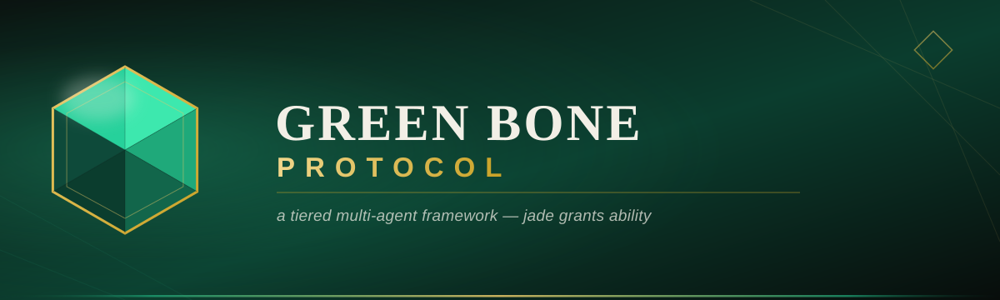
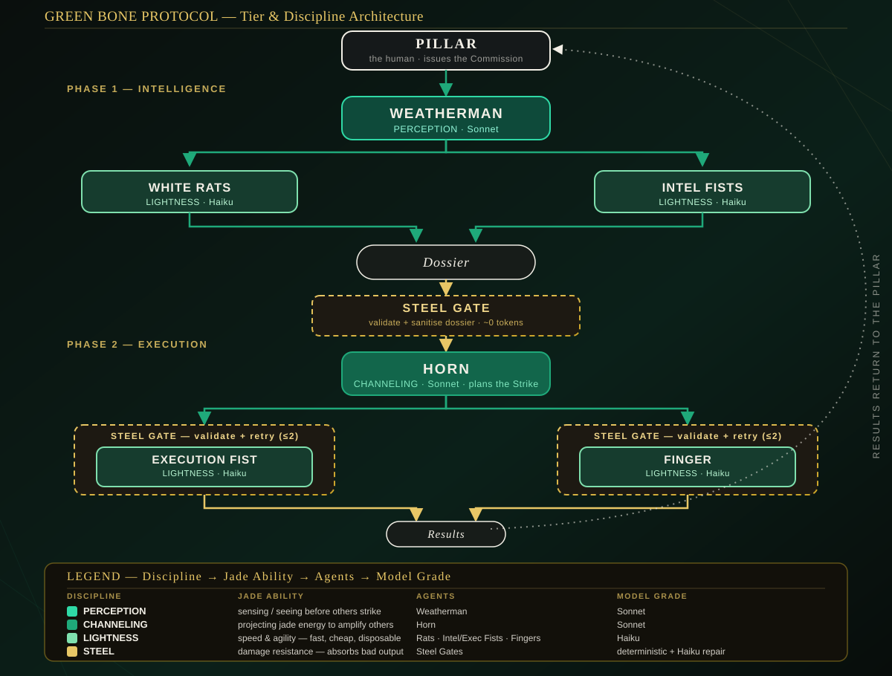

Green Bone Protocol is a tiered multi-agent framework where a small number of high-judgment "Command" agents (Sonnet) coordinate a swarm of cheap, disposable "Field" agents (Haiku) to research a target and execute a commission. Terminology is drawn from Fonda Lee's Green Bone Saga. The pipeline runs in two phases: a **Weatherman** gathers intelligence into a sealed **Dossier**, then a **Horn** plans and executes a **Strike** against it.

## Tier architecture



Every agent in the clan carries two independent attributes. Conflating them is the mistake this design deliberately avoids.

**Role** — the org position, straight from the novel: Pillar (the human operator), Weatherman (intel commander), Horn (execution commander), White Rat (scout), Intel Fist, Execution Fist, Finger.

**Discipline** — the jade ability an agent channels, which is this framework's actual capability tier and maps directly to model grade:

| Discipline | Jade ability | Agents | Model grade |
|---|---|---|---|
| **PERCEPTION** | Sensing / intelligence — seeing before others strike | Weatherman | Sonnet |
| **CHANNELING** | Amplifying and coordinating other agents | Horn | Sonnet |
| **LIGHTNESS** | Speed — fast, cheap, disposable | White Rats, Intel Fists, Execution Fists, Fingers | Haiku |
| **STEEL** | Damage resistance — validation and hardening | Steel gates | Deterministic (near-zero-token), optional Haiku repair |

#### Why Channeling is a discipline, not a rename of the Horn

In the novel, Channeling is the ability to project jade energy *into another* Green Bone to amplify them — which is exactly what the Horn does architecturally, turning a set of cheap Fists into one coordinated strike. Role and discipline are two different vocabularies in the source material, and collapsing "Horn" into "Channeling" would blur the intel-commander/execution-commander split the system depends on. Keeping Horn as the role and Channeling as its discipline instead adds a genuine second classification axis — every agent now has an org position *and* a capability tier — rather than just reskinning an existing name.

## The Steel tier

Steel is a defensive validation layer, not a label. It sits at the two seams where bad upstream output would otherwise propagate:

- **Dossier Gate** — after the Weatherman synthesises, before the Horn ever sees the result. Deterministic validation and sanitisation: required-field checks, control-character stripping, per-field length caps, and stripping of obvious prompt-injection lines (e.g. "ignore previous instructions"). If the Dossier is structurally broken, Steel can attempt one optional Haiku repair pass; otherwise it degrades safely rather than crashing the pipeline.
- **Strike Gate** — wraps every Execution Fist result inside the Horn's loop. Validates that output is non-empty, that anything that looks like code parses via `compile()`, and that anything that looks like JSON loads cleanly — retrying the fist up to 2 times before marking the result failed.

Steel's core is pure Python: no LLM calls, near-zero token cost, a defensive layer that is effectively free. See `greenbone/steel.py` and `tests/test_steel.py` (8 passing tests, no API calls).

## Approximate cost comparison (tiered vs. all-Command)

**These are APPROXIMATE figures derived from tokenizing real logged prompt/response text with tiktoken (cl100k_base), NOT measurements of real Anthropic API `usage` fields.**

A recorded commission (a research run on "Anthropic") was tokenized offline. Token counts are identical between the two configurations below — same prompts, same responses — so the tiered split doesn't reduce tokens, it reduces *cost*, by routing the high-volume Field/Lightness calls to Haiku instead of Sonnet. Because the counts are identical across configs, any systematic undercount in tiktoken's approximation cancels out of the percentage ratio.

Pricing: Sonnet (`claude-sonnet-4-6`) $3 / $15 per 1M input/output tokens; Haiku (`claude-haiku-4-5`) $1 / $5.

| Tier | Model | Calls | Input tokens (approx) | Output tokens (approx) |
|---|---|---:|---:|---:|
| Command (PERCEPTION + CHANNELING) | claude-sonnet-4-6 | 2 | 2,716 | 476 |
| Field (LIGHTNESS) | claude-haiku-4-5 | 12 | 11,534 | 10,692 |
| Steel (STEEL) | deterministic, no LLM | — | ~0 | ~0 |

| Configuration | Input $ | Output $ | Total $ |
|---|---:|---:|---:|
| **Tiered (Green Bone Protocol)** | $0.0197 | $0.0606 | **$0.0803** |
| **All-Command baseline** | $0.0428 | $0.1675 | **$0.2103** |

**Approximate cost reduction, tiered vs. all-Command: ~62%** (precisely 61.8% on these approximate counts).

The theoretical ceiling is ~66.7% — the pure Haiku-vs-Sonnet price ratio if 100% of work were Field-tier — and the tiered split captures ~62% of it because two Command-tier calls (Weatherman synthesis, Horn planning) stay at full Sonnet price regardless of configuration. Some Field-tier token counts are heuristic (unlogged rat/intel-fist completions estimated at ~55% of `max_tokens`), while all Command calls and the logged Finger outputs plus the Dossier are tokenized from real recorded text. The script is re-runnable and offline: see `tools/estimate_tokens.py` and `output/token_estimate.json`.

## Usage

### Install

```bash
pip install -r requirements.txt
export ANTHROPIC_API_KEY=sk-...
```

### CLI (`run.py`)

```bash
# list available task configs
python run.py list

# Weatherman only — gather intel, return a sealed Dossier
python run.py intel --target "Anthropic" --goal "Tech stack analysis" \
  --urls https://anthropic.com --save-dossier

# full commission — Weatherman + Steel + Horn
python run.py commission --target "Stripe" --goal "Build a Python SDK" \
  --urls https://stripe.com --github stripe \
  --save-dossier --save-output
```

Additional flags: `--task <name>` to select a task config other than `default` (see `python run.py list`), `--token` for a GitHub personal access token.

### Python API

```python
from tasks.default.task import build_clan

clan = build_clan()
result = clan.commission(
    goal="Build a Python SDK",
    target="Stripe",
    context={"urls": ["https://stripe.com"], "github_org": "stripe"},
)

result["dossier"]  # sealed, Steel-validated Dossier
result["horn"]      # list of Steel-guarded Results from the Strike
```

## Project layout

```
greenbone/
├── agents.py     — Agent base class (Command/Field model wiring)
├── clan.py       — WhiteRat, IntelFist, Finger, ExecutionFist, Weatherman, Horn, Clan
├── steel.py      — the STEEL discipline: Dossier Gate + Strike Gate
└── types.py      — Task, Result, Dossier, Rank, Discipline
tasks/            — pluggable commission configs, each exporting build_clan()
tools/
└── estimate_tokens.py   — offline tiktoken cost study, re-runnable
tests/            — unit tests (no API calls)
assets/           — banner.svg, architecture.svg
run.py            — CLI entry point (list / intel / commission)
server.py         — optional WhatsApp gateway built on the same Clan
```

## Concepts glossary

| Term | Meaning |
|---|---|
| **Commission** | A goal + target issued by the Pillar to the clan. |
| **Dossier** | The sealed intel package handed from Weatherman to Horn — the only channel between the two phases. |
| **Strike** | The execution phase: Horn's plan carried out by Execution Fists and Fingers. |
| **Pillar** | The human operator who issues the commission. |
| **Weatherman** | Intelligence commander (PERCEPTION, Sonnet). Deploys Rats and Intel Fists, seals the Dossier. |
| **Horn** | Execution commander (CHANNELING, Sonnet). Plans the Strike and assigns subtasks to Fists. |
| **Fist** | An Intel Fist cleans raw scout data; an Execution Fist carries out a class of Strike work. |
| **Finger** | A single atomic action, invoked from inside an Execution Fist. |
| **White Rat** | A disposable scout that returns raw, uninterpreted data. |
